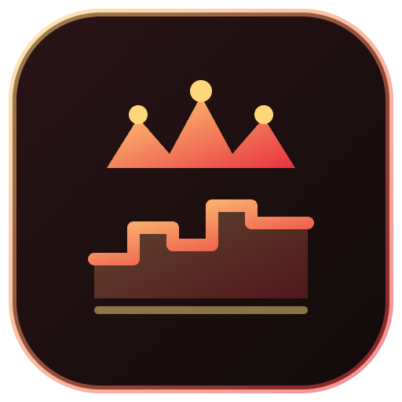

<div align="center">



# VRCLogs

**Les logs avancés de tes soirées VRChat.**
Qui était là, combien de temps, dans quel monde, avec quel avatar — tout, en direct et pour toujours.

[⬇️ Télécharger](../../releases/latest) · [🐛 Signaler un bug](../../issues) · [📚 Comprendre le code](GUIDE.md)

</div>

---

## ✨ Fonctionnalités

- 🟢 **En direct** — l'instance où tu es, qui est présent, depuis combien de temps, première rencontre ou non
- 💜 **Amis** *(compte VRChat, optionnel)* — qui est en ligne, dans quel monde, tes groupes de favoris, bouton « Rejoindre »
- 🧍 **Avatars** — regarde l'avatar actuel de tes amis en grand et la galerie de tes propres avatars
- 🧠 **Cerveau d'amis** — une carte interactive de tes relations
- 🎮 **Steam** — tes heures exactes sur VRChat et tes amis Steam qui y jouent
- 📰 **Nouveautés** — les mises à jour officielles de VRChat et les boutiques des mondes visités (affichage seulement)
- 📈 **Graphique d'instance** — le nombre de joueurs au fil du temps ; survole-le pour voir qui était là à chaque minute
- 📅 **Résumé du jour** — temps de jeu, mondes, nouvelles rencontres, moment fort de la journée
- 📜 **Journal** — arrivées, départs, avatars, vidéos ; recherche, filtres et export CSV
- 🌍 **Historique des mondes** — chaque instance visitée avec sa chronologie complète
- 👥 **Personnes** — temps passé ensemble, rencontres, anciens pseudos, historique des avatars
- 📝 **Notes et tags** — écris une note sur quelqu'un, classe tes contacts avec des `#tags`
- 🔔 **Alertes** — notification quand un favori, un tag ou une nouvelle personne arrive dans ton instance
- 🫂 **Cercles d'amis** — détecte les joueurs qui arrivent et repartent ensemble
- 🏛️ **Groupes VRChat** — tes groupes, leurs annonces, et les instances de groupe ouvertes en ce moment
- 🎵 **Vidéos** — toutes les vidéos et musiques jouées, avec compteur
- 📊 **Statistiques** — heures de jeu, mondes favoris, personnes les plus vues, avatars populaires
- 💾 **Historique permanent** — VRChat efface ses vieux logs, VRCLogs les garde
- 🎨 **Thèmes** — Goddess, Violet, Océan, Menthe + mode compact

## 🌍 Langues

Français · English · Español · Português · Deutsch · Italiano · Русский · 日本語 · 한국어 · 中文

VRCLogs suit la langue de Windows, et tu peux la changer dans **⚙️ Paramètres → Apparence**.
Les traductions sont dans `ui/lang/` : pour améliorer une traduction ou ajouter ta langue, copie `ui/lang/en.js`,
traduis la colonne de droite, et propose-la dans une *Pull Request* !

## 📥 Installation

1. Va dans les [Releases](../../releases/latest) et télécharge `VRCLogs-Setup-x.x.x.exe`
2. Lance l'installateur
3. Ouvre VRCLogs, puis lance VRChat — c'est tout !

> **Windows affiche « Windows a protégé votre ordinateur » ?**
> C'est normal pour une petite app pas encore connue de Microsoft. Clique sur **Informations complémentaires → Exécuter quand même**.

## 🔒 Vie privée et sécurité

- Les logs viennent **uniquement des fichiers** que VRChat écrit sur ton PC
  (`%LocalAppData%Low\VRChat\VRChat\output_log_*.txt`). Tout reste sur ton ordinateur (`%AppData%\VRCLogs`).
- La **connexion au compte VRChat est optionnelle** (seulement pour les amis et les avatars) :
  - ton mot de passe est envoyé **uniquement aux serveurs de VRChat** et n'est **jamais enregistré** ;
  - seul le jeton de session est gardé, **chiffré par Windows** ;
  - aucune autre donnée n'est envoyée ailleurs.
- Les avatars peuvent être **regardés**, jamais téléchargés ni copiés, par respect pour leurs créateurs.
- Pour savoir si un avatar vu dans tes logs est public, VRCLogs envoie **uniquement son nom** à la base publique
  [avtrDB](https://avtrdb.com). Désactivable dans *Paramètres → Données*.
- **Steam** : les heures de jeu sont lues dans les fichiers de Steam sur ton PC. Pour les amis Steam, tu peux ajouter
  ta propre clé API Steam (optionnelle) : elle est **chiffrée par Windows** et envoyée **uniquement à Steam**.
- Les boutiques sont en **affichage seulement** : aucun achat n'est possible depuis VRCLogs.
- VRCLogs **ne modifie pas** le jeu et n'interagit pas avec lui.
- Comme VRCX, VRCLogs utilise l'API web de VRChat, qui n'est pas officiellement documentée.

## 🛠️ Lancer depuis le code source

Il faut [Node.js](https://nodejs.org) (version LTS).

```bash
git clone https://github.com/TheGoddessQc/VRCLogs.git
cd VRCLogs
npm install
npm start
```

Créer l'installateur Windows : `npm run dist` (le fichier apparaît dans `dist/`).

## 🤝 Contribuer

Les idées et rapports de bugs sont les bienvenus dans les [Issues](../../issues).
Pour comprendre comment le code est organisé, lis le [guide](GUIDE.md).

## ⚖️ Avertissement

VRCLogs est un projet personnel et **n'est pas affilié à VRChat Inc.**, ni approuvé ou soutenu par VRChat Inc.
« VRChat » est une marque de VRChat Inc. Ce logiciel est fourni « tel quel », sans garantie.

## 📄 Licence

[MIT](LICENSE) © 2026 TheGoddessQc
